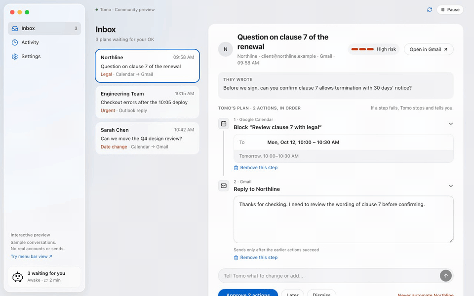
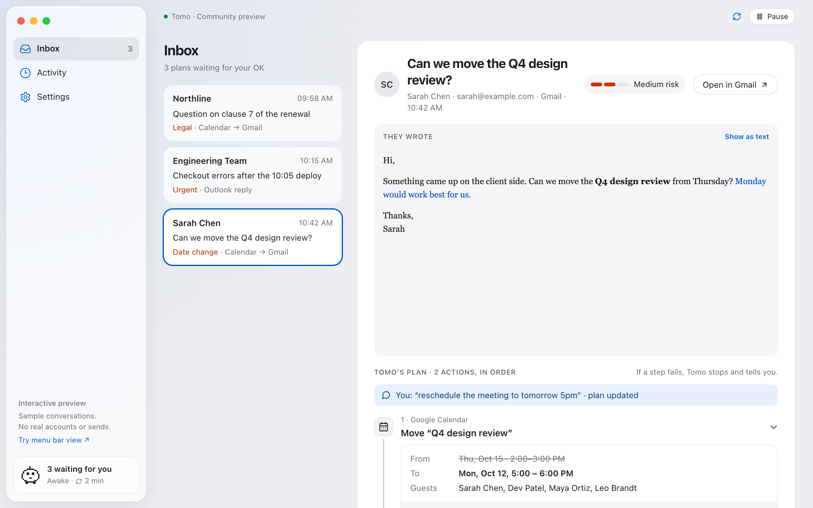
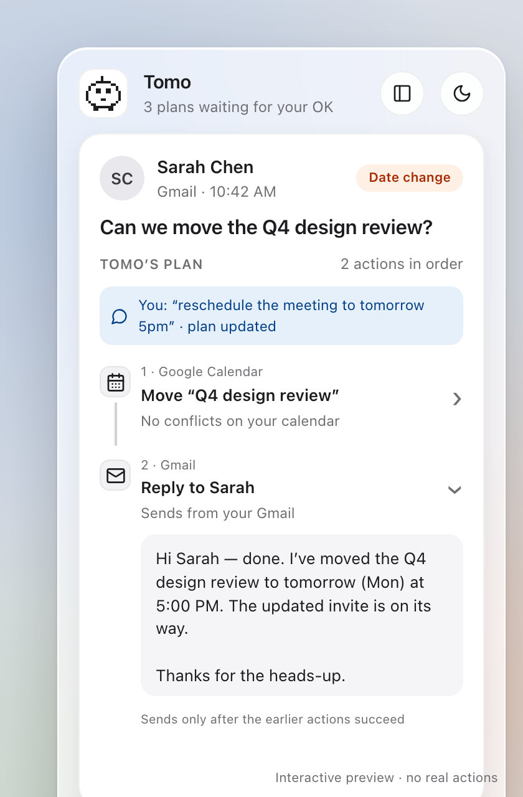
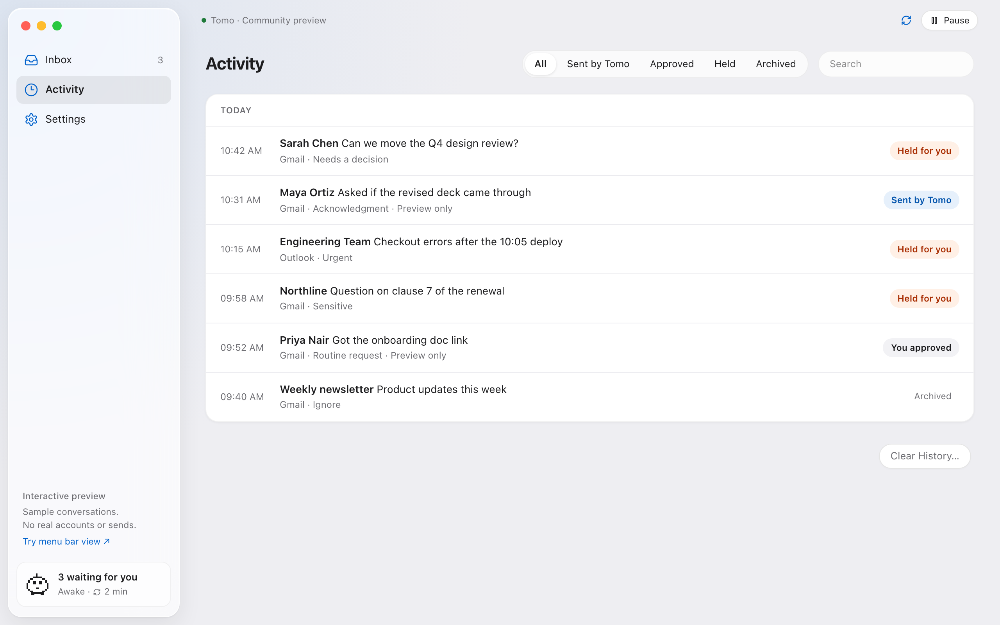
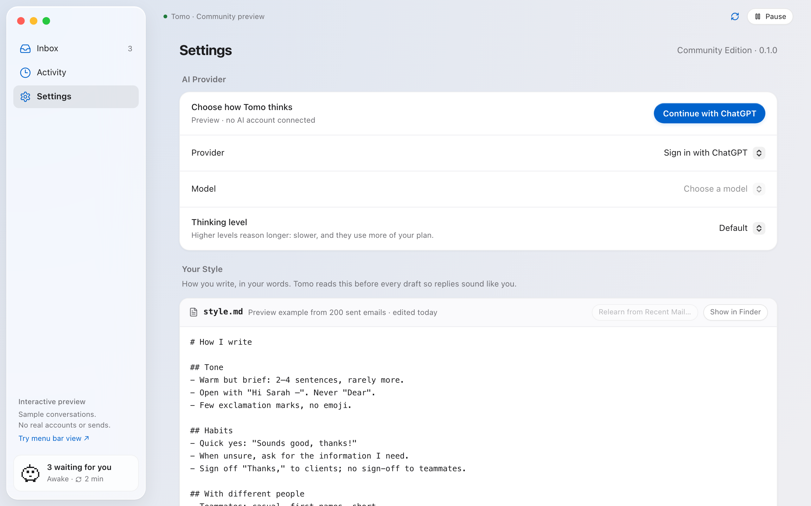

<div align="center">


# Tomo

**A local-first assistant for your inbox that does the work and asks before it acts.**

Tomo reads new Gmail, Outlook and Slack messages, sorts them, drafts replies in your own writing style, and prepares a plan for each one (move the meeting, share the file, then reply). Nothing runs until you approve it.

[](https://github.com/nagiflow/tomo/actions/workflows/ci.yml)
[](LICENSE)


[How it works](#how-it-works) · [Download](#install) · [Connect your accounts](#connect-your-accounts) · [Privacy](#local-data-and-privacy) · [Contributing](CONTRIBUTING.md)

<br>



<sub>Recorded in the browser preview with sample conversations. No real accounts or sends.</sub>

</div>

## How it works

```
   Gmail · Outlook · Slack
              │  a new message arrives
              ▼
  ┌───────────────────────┐
  │ 1  Read and sort      │  Does it need a reply? How risky is it?
  │                       │  The AI decides; fixed safety checks back it up.
  └───────────┬───────────┘
              ├──────────────▶  Newsletters and FYIs are filed, no reply
              ▼
  ┌───────────────────────┐
  │ 2  Make a plan        │  Looks up your calendar and Drive, follows your
  │                       │  rules.md, drafts the reply in your style.md
  └───────────┬───────────┘
              ▼
  ┌───────────────────────┐
  │ 3  You decide         │  Edit or remove steps, or just say what to change
  │                       │  ("make it 5:30"), then approve
  └───────────┬───────────┘
              │                 (Easy replies can skip this step if you allow it)
              ▼
  ┌───────────────────────┐
  │ 4  Tomo runs the plan │  Move meeting ─▶ share file ─▶ ... ─▶ send reply
  │                       │  in order; it stops and tells you if a step fails
  └───────────┬───────────┘
              ▼
       Activity log         What happened, and why
```

Everything runs on your Mac. Tomo talks directly to your mail, Slack, Google tools and the AI provider you chose. There is no Tomo server in between.

## Features

- **Plans, not just drafts.** For each message Tomo proposes ordered steps across your tools, such as moving a Google Calendar event, sharing a Drive file, creating a Doc, Sheet or Slides deck, posting to Slack, or handing a task to Codex. A reply comes last and is sent only after the earlier steps succeed.
- **You stay in control.** Edit any step, remove the ones you don't want, or tell Tomo in plain words what to change ("make it 5:30 and add a Meet link"). Writes always wait for your approval unless you opt in to more.
- **Writes like you.** Tomo learns a `style.md` from your sent mail. You can read and edit it.
- **Standing rules.** `rules.md` holds instructions such as "when an invoice arrives, post it in #finance".
- **Lives in the menu bar.** Review and approve from a compact popover. Closing the main window leaves Tomo running in the background.
- **Explains itself.** Every decision lands in a searchable Activity log with the reason, the risk and exactly what was sent.
- **Local-first and encrypted.** Messages, drafts and history are AES-256-GCM encrypted in a local SQLite database.

<table>
  <tr>
    <td width="66%"></td>
    <td width="34%"></td>
  </tr>
  <tr>
    <td align="center"><sub>Inbox: the message, why Tomo asked, and its plan</sub></td>
    <td align="center"><sub>Menu bar popover</sub></td>
  </tr>
  <tr>
    <td></td>
    <td></td>
  </tr>
  <tr>
    <td align="center"><sub>Activity: what happened and why</sub></td>
    <td align="center"><sub>Settings and <code>style.md</code></sub></td>
  </tr>
</table>

## Install

[**Download the latest Tomo.dmg**](https://github.com/nagiflow/tomo/releases/latest) (macOS 12 or newer, Apple silicon and Intel).

Open the `.dmg`, drag **Tomo** into Applications, and launch it. The app is signed and notarized by Apple, so it opens without security warnings and needs nothing else installed. Tomo then walks you through connecting your accounts.

## Connect your accounts

Tomo has no shared OAuth app and no vendor server: you bring your own registrations, and your data goes straight from your Mac to the providers.

| Service | How it connects |
| --- | --- |
| **Gmail**, Calendar, Drive, Docs, Sheets, Slides, Contacts | Your own Google OAuth client |
| **Outlook** | Your own Microsoft app registration |
| **Slack** | Your own Slack app |
| **AI** | Continue with ChatGPT, or an OpenAI API key |
| **Codex** (optional) | Runs locally inside a folder you choose |

Step-by-step registration for each one is in **[docs/ACCOUNT_SETUP.md](docs/ACCOUNT_SETUP.md)**. Enter the client IDs during onboarding or under **Settings → Inboxes**. Sign-in always opens your system browser, and Tomo never asks for a mailbox password. Each inbox type can connect several accounts or workspaces.

After connecting AI, refresh the model list, pick a model, and turn on background processing consent. ChatGPT eligibility and usage allowances are set by OpenAI.

## How automation works

Out of the box, **every write waits for you**. You can loosen this step by step:

| Setting | What Tomo does on its own |
| --- | --- |
| Default | Sorts mail and drafts plans; nothing is sent |
| **Send the easy ones** | Sends its own reply to acknowledgments and routine requests, but only to people you have emailed before (any Slack DM or mention counts) |
| **Rules** that allow it | Posts to Slack right away; replies and other changes still wait |
| **YOLO mode** | Runs every plan as soon as it is made. A red flag shows in the status bar while this is on |

Model judgment is backed by deterministic checks. Sensitive topics, commitments, money and uncertainty always need your approval. "Never automate" for a sender or thread, pausing, and any failed step stop automation in every mode. A request a provider has already accepted cannot be recalled.

## Local data and privacy

- **Encrypted at rest.** Message content, drafts, account metadata, preferences, rules and history are AES-256-GCM encrypted before they reach SQLite. The key lives in the macOS Keychain and is read once per launch. OAuth tokens and API keys sit in a separate file encrypted with that key.
- **What leaves your Mac.** With your consent, a bounded amount of each new message and its thread is sent to the AI provider you chose, with `store: false`. That provider's retention terms still apply.
- **Disconnecting** an inbox deletes its credentials and its locally cached messages, drafts and history. It does not touch mail held by the provider; revoke access in your provider account if you want that too.
- **No double sends.** Send attempts are recorded before they go out. An uncertain outcome stays blocked until it is confirmed with the provider, and minimal send records survive history deletion and resets.

## Contributing

Bug reports, fixes, docs and new tool integrations are welcome. [CONTRIBUTING.md](CONTRIBUTING.md) explains how to build Tomo from source, try it without any accounts, and run the checks.

## Security

Please don't open a public issue for a vulnerability. Report it privately through [GitHub security advisories](https://github.com/nagiflow/tomo/security/advisories/new).

## Roadmap

Microsoft Teams, local model inference, managed enterprise policies, and Windows distribution are planned for later phases.

## License

[MIT](LICENSE) © Tomo contributors
